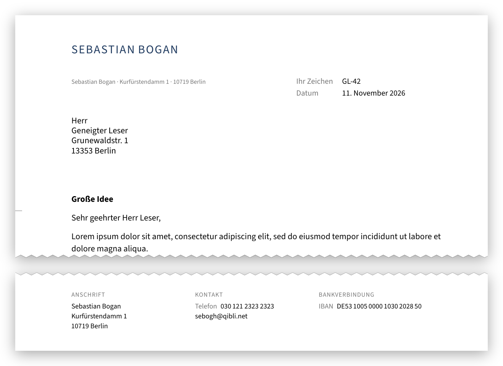

# gbn

LaTeX-Klasse für deutsche Geschäftsbriefe nach
[DIN 5008](https://de.wikipedia.org/wiki/DIN_5008) (Form A), passend für
Fensterumschläge DIN lang (DL) und C6/5.

<p align="center">
    <a href="intro.pdf"></a>
</p>

## Funktionen

- Anschriftfeld, Rücksendeangabe und Zusatz- und Vermerkzone liegen
  vollständig im Umschlagfenster, auch bei sechszeiligen Anschriften
- Informationsblock rechts neben der Anschrift mit Bezugszeichen, Datum und
  Seitenzahl
- Fußzeile mit Anschrift, Kontakt und Bankverbindung in festem Raster;
  leere Spalten bleiben frei
- Seitenzahlen ("Seite 1 von 2") nur bei mehrseitigen Briefen
- Falz- und Lochmarken, Flattersatz, Unterschrift als Bild
- Akzentfarbe und Schrift frei wählbar

## Erste Schritte

### Voraussetzungen

- **XeLaTeX** (oder LuaLaTeX); pdfLaTeX wird nicht unterstützt, da die Klasse
  `fontspec` verwendet
- die LaTeX-Pakete `kvoptions`, `eso-pic`, `microtype`, `xcolor`, `babel`
  (`ngerman`), `ragged2e`, `tabularx`, `hyperref`, `graphicx` und `fontspec`
- optional die Schrift **Source Sans 3**; fehlt sie, wird TeX Gyre Heros
  verwendet

### Installation

**Debian/Ubuntu**

```sh
sudo apt install texlive-xetex texlive-latex-recommended texlive-lang-german \
                 fonts-adobe-sourcesans3
```

**macOS:** [MacTeX](https://www.tug.org/mactex/) installieren, Source Sans 3
von [GitHub](https://github.com/adobe-fonts/source-sans/releases) laden und
per Doppelklick installieren.

**Windows:** [MiKTeX](https://miktex.org/) oder
[TeX Live](https://www.tug.org/texlive/) installieren, Source Sans 3 wie
unter macOS.

Anschließend die Klasse erzeugen und ins persönliche TeX-Verzeichnis
(`TEXMFHOME`, meist `~/texmf`) installieren:

```sh
make install
```

### Erster Brief

```latex
\documentclass{gbn}

\fromname        {Sebastian Bogan}
\fromstrassehaus {Kurfürstendamm 1}
\fromplzort      {10719 Berlin}
\fromtelefon     {030\,121 2323 2323}
\fromemail       {sebogh@qibli.net}
\fromiban        {DE53\,1005\,0000\,1030\,2028\,50}

\toanrede        {Herr}
\toname          {Geneigter Leser}
\tostrassehaus   {Grunewaldstr. 1}
\toplzort        {13353 Berlin}

\ihrzeichen      {GL-42}
\betreff         {Große Idee}
\begruessung     {Sehr geehrter Herr Leser,}

\begin{document}
Lorem ipsum dolor sit amet, consectetur adipiscing elit, sed do
eiusmod tempor incididunt ut labore et dolore magna aliqua.
\end{document}
```

Übersetzen mit:

```sh
xelatex brief.tex
xelatex brief.tex   # zweiter Lauf für "Seite 1 von n"
```

## Verwendung

Die vollständige Referenz aller Optionen und Kommandos steht in
[gbn.pdf](gbn.pdf). Hier die wichtigsten:

### Optionen

| Option | Bedeutung |
|---|---|
| `rules` | Linien unter der Kopfzeile und über der Fußzeile |
| `plain` | ohne Elemente der ersten Seite (Anschrift, Kopf usw.) |
| `english` | `babel` ohne `ngerman` laden |
| `subjectsep=<dim>`, `salutsep=<dim>`, `bodysep=<dim>` | zusätzlicher Abstand vor dem Betreff, nach dem Betreff bzw. nach der Anrede |

### Häufige Kommandos

| Bereich | Kommandos |
|---|---|
| Absender | `\fromtitel`, `\fromname`, `\fromstrassehaus`, `\fromplzort`, `\fromland`, `\fromtelefon`, `\fromemail`, `\fromhttp`, `\fromiban`, `\frombic` |
| Empfänger | `\tofirma`, `\toanrede`, `\totitel`, `\toname`, `\tostrassehaus`, `\toplzort`, `\toland` |
| Informationsblock | `\ihrzeichen`, `\ihrenachricht`, `\unserzeichen`, `\datum` (Standard `\today`) |
| Vermerke | `\zvzone` (z.B. "Einschreiben"), `\zvztwo`, `\zvzthree` |
| Inhalt | `\betreff`, `\begruessung`, `\gruss`, `\unterschrift`, `\signatur{<Bilddatei>}`, `\anlagen` |

### Anpassen

```latex
\accentcolor{7A1F2B}             % Farbe des Namens im Kopf (HTML-Hex, ohne #)
\mutedcolor{767676}              % Farbe für Beschriftungen und Marken
\setmainfont{IBM Plex Sans}      % andere Schrift
\telefontext{Tel.}               % Beschriftungen ändern
```

## Entwicklung

Klasse, Dokumentation und Testbriefe stammen aus `gbn.dtx` (docstrip);
`gbn.ins` erzeugt daraus `gbn.cls`, `test-simple.tex` und `test-complete.tex`.

| Befehl | Ergebnis |
|---|---|
| `make` | Klasse, Dokumentation `gbn.pdf` und Testbriefe |
| `make install` | `gbn.cls` nach `TEXMFHOME/tex/latex/gbn/` und die Dokumentation `gbn.pdf` nach `TEXMFHOME/doc/latex/gbn/` installieren |
| `make intro.png` | Bild oben aus dem Beispiel unter "Erster Brief" neu erzeugen (benötigt `poppler-utils` und `python3-pil`) |
| `make clean` / `make tidy` | Hilfsdateien bzw. alle erzeugten Dateien löschen |

## Lizenz

[MIT](LICENSE)
